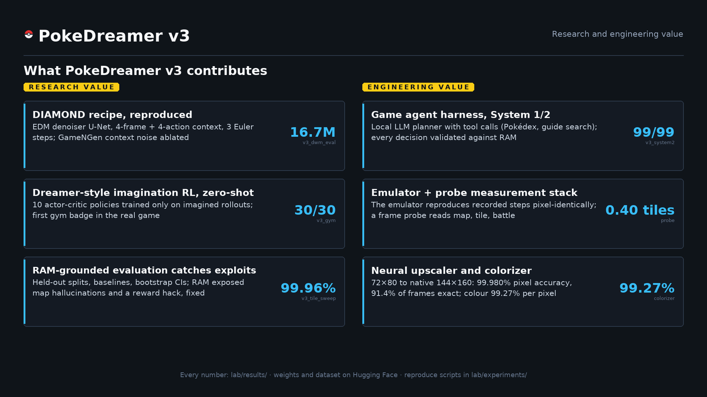
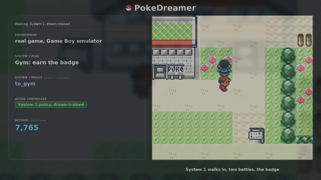
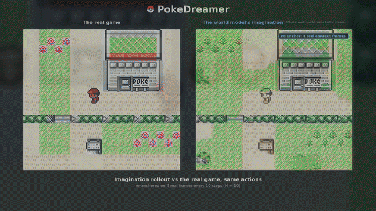
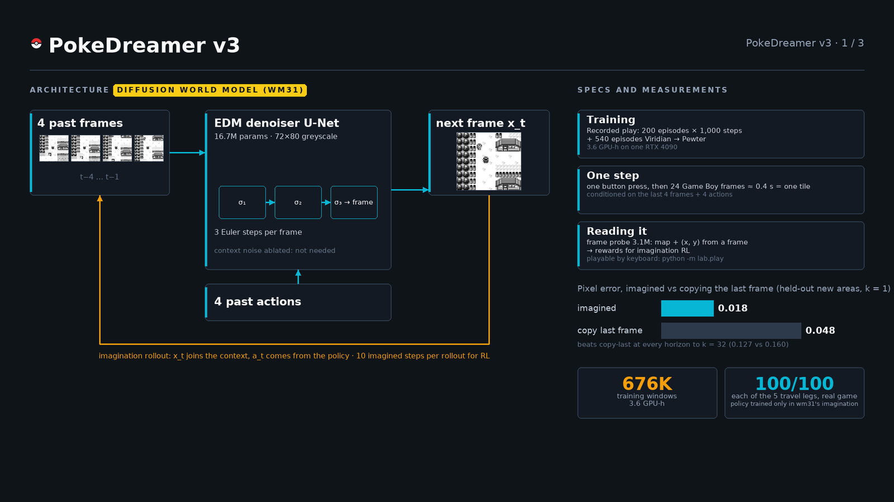
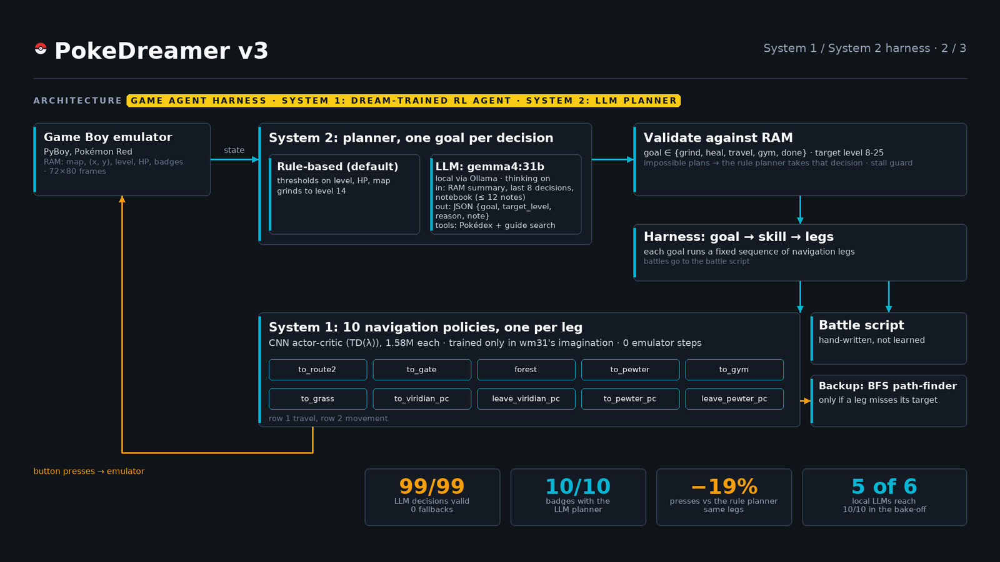
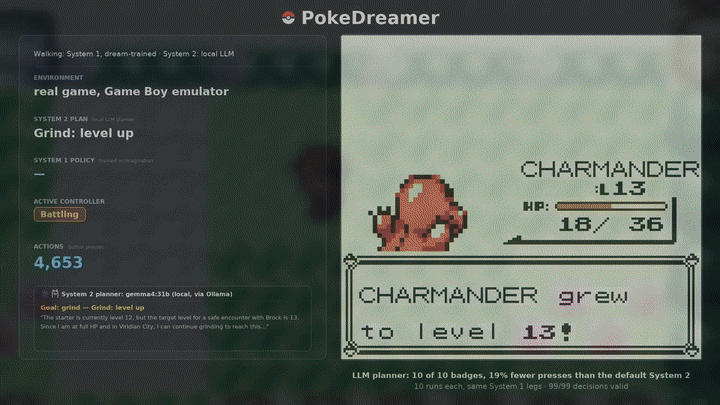

# PokeDreamer

**A diffusion world model of Pokémon Red, measured against the game's own memory, and an agent whose navigation was learned entirely inside it that wins the first gym in the real game.**

[](https://github.com/xoTEMPESTox/PokeDreamer/actions/workflows/tests.yml)
[](LICENSE)
· [Website](https://pokedreamer.priyanshusah.com) · [Model weights](https://huggingface.co/xxxTEMPESTxxx/PokeDreamer) · [Dataset](https://huggingface.co/datasets/xxxTEMPESTxxx/PokeDreamer) · [Results](lab/results/README.md) · [Showcase video (2:11)](docs/assets/v3/pokedreamer_v3_showcase.mp4)

<p align="center"><br><sub>The showcase's 3D opening: the first town rebuilt from the game's map data, the neural upscaler and colorizer restoring the screen, and a System 1 policy trained only in the world model walking the first leg.</sub></p>

<p align="center">
  <a href="docs/assets/v3/pokedreamer_v3_showcase.mp4"><strong>Watch showcase video </strong></a> · <a href="https://pokedreamer.priyanshusah.com/v3.html#showcase"><strong>Interactive showcase with chapters</strong></a>
</p>

## In 30 seconds
- **A world model of a real game.** A diffusion model learned to predict Pokémon Red frame by frame from recorded play: you press a button, it imagines the next screen.
- **An agent that learned inside the dream.** Ten navigation skills were trained purely in that imagination, with zero real-game steps, then dropped into the real game, where the agent wins the Boulder Badge in **30/30** runs.
- **Measured, not eyeballed.** The game's own memory says exactly where the agent and the imagined world really are, so every claim below is a number: where the dream drifts, which shortcuts the agent learned to exploit, and why battles can't be learned this way.
- **Seen in colour.** A neural upscaler and colorizer turn the 72x80 greyscale frames into full-resolution colour for display (99.27% per-pixel accuracy on held-out frames).

<p align="center">
  
  <br>
  <sub>Research and engineering contributions at a glance; every number from <a href="lab/results/README.md"><code>lab/results/</code></a>.</sub>
</p>

<table>
<tr>
<td width="50%"></td>
<td width="50%"></td>
</tr>
<tr>
<td><sub>Winning the Boulder Badge in the real game: every walk is executed by a System 1 policy trained only in the world model; 30/30 runs (<a href="lab/results/v3_gym.md">v3_gym</a>).</sub></td>
<td><sub>Imagination rollout: the diffusion world model imagining the same moments from the same buttons, re-anchored on 4 real frames every 10 steps, beside the real emulator (<a href="lab/results/v3_dwm_eval.md">v3_dwm_eval</a>).</sub></td>
</tr>
</table>

## What this is
A research project on world models for game agents, built around one advantage a game gives you: the emulator's RAM is ground truth for every imagined frame. That makes it possible to measure, in game units (tiles, maps, battle turns), what a learned simulator gets right, where it drifts, and how a policy trained inside it exploits its mistakes.

- **World model:** wm31, a DIAMOND-style diffusion model of 72×80 frames, 16.7M parameters, conditioned on the last 4 frames and buttons.
- **Agent:** a System 1/2 design. Ten navigation legs (System 1) are small policies trained purely in the world model's imagination, with zero real-game steps. Battles and goal sequencing (System 2) are rules; a bake-off also tested local LLMs as System 2.
- **Measurement:** held-out episodes split by episode, a frame probe that reads map, tile and battle state from pixels, baselines (no-change, copy-last, greedy path-following, PPO in the real game), 3 seeds, bootstrap confidence intervals.

<p align="center">
  
  <br>
  <sub>Architecture of the EDM diffusion world model: 4-frame context denoiser predicting next-frame pixels conditioned on past actions (<a href="lab/results/v3_dwm_eval.md">v3_dwm_eval</a>).</sub>
</p>

## Game harness: System 1 / System 2
System 2 selects the next sub-goal from verified RAM state, can call tools including Pokédex lookup and guide search over Bulbapedia (`lab/agent/web_search.py`), and every decision is validated against game memory before execution. System 1 executes each leg using navigation policies trained entirely in the world model's imagination, achieving 10/10 badges with the local LLM planner at a median 7,144.5 presses (vs 8,779.5 for the rule-based baseline) with 99/99 decisions valid ([v3_system2](lab/results/v3_system2.md)).

<table>
<tr>
<td width="55%"></td>
<td width="45%"></td>
</tr>
<tr>
<td><sub>Game harness architecture: System 2 plans sub-goals, validates against RAM, and dispatches System 1 navigation policies (<a href="lab/results/v3_system2.md">v3_system2</a>).</sub></td>
<td><sub>LLM System 2 planner running live: reading RAM state, choosing sub-goals, and dispatching imagination-trained navigation legs (<a href="lab/results/v3_system2.md">v3_system2</a>).</sub></td>
</tr>
</table>

## Headline results (measured; sources in [`lab/results/`](lab/results/README.md))
| | result | page |
|---|---|---|
| Boulder Badge, real game, 10-leg agent | **30/30 runs** (3 seeds × 10) | [v3_gym](lab/results/v3_gym.md) |
| Runs where every navigation leg is a world-model policy (no fallback anywhere) | **14/30** | [v3_gym](lab/results/v3_gym.md) |
| Navigation legs at 100/100 on all 3 seeds | 7 of 10; to_pewter_pc 100/0/100, forest 100/69/97 | [v3_gym](lab/results/v3_gym.md) |
| Start-tile robustness after fixing a reward hack (move gate) | **2,339/2,340** episodes over 26 start tiles | [v3_tile_sweep](lab/results/v3_tile_sweep.md) |
| Can battles be trained inside this world model? | **No:** imagined battles end early in 74.6% of held-out windows (real-frame probe: 1.1%) | [v3_battle_fidelity](lab/results/v3_battle_fidelity.md) |
| Local LLMs as System 2 | 5 of 6 reach 10/10 badges | [v3_system2](lab/results/v3_system2.md) |

<p align="center"></p>

## What the measurements showed
- **Policies exploit the model's errors, and RAM is what reveals it.** A per-step reward clip let policies farm a ledge loop (+4 per loop); a potential-based "move gate" fixed it (2,339/2,340). The frame probe confuses the identical-looking Pokémon Center interiors, so pressing *right* on the Pewter Center mat looked like an exit in imagination; treating Center reads as one interior took leave_pewter_pc from 72/68/100 to 100/100/100 (figure above).
- **Drift depends on the map.** On the best-covered map (Viridian City) imagined position error at 8 steps beats the no-change baseline (2.71 vs 3.64 tiles); in Viridian Forest it is 15.65 tiles, far above the probe's own error on real forest frames (about 2), so the model imagines plausible forest somewhere else. See [v3_dwm_eval](lab/results/v3_dwm_eval.md).
- **Battles are out of reach for a 4-frame pixel model**: battle onset is roughly right, but imagined battles end early and their frames are worse than copying the last frame from 2 steps on.
- **Honest scope:** with a fast emulator the world model is *not* a sample-efficiency win: PPO in the real game reaches ≥95% within 10.8k-41.5k real steps on the same navigation tasks ([v3_agent](lab/results/v3_agent.md)). Its value here is as a measured object and a simulator you can train in without touching the game. Battles and planning are rules.

<p align="center"></p>

## Next: Path B (planned)
Path B is the next step: training battle policies inside the world model, so battles are learned in imagination the way navigation already is. This requires a battle-capable world model with longer context or RAM-conditioning, retrained on battle windows to maintain battle state and round transitions ([v3_battle_fidelity](lab/results/v3_battle_fidelity.md)). The compute requirement is estimated at ~50 GPU-hours on one RTX 4090 (planned), waiting for compute.

## Run it
You need your own legally obtained Pokémon Red ROM (not included) at `Pokemon - Red Version (USA, Europe).gb` in the repo root.

```bash
conda create -n pokedreamer python=3.11 && conda activate pokedreamer
pip install torch==2.5.1 --index-url https://download.pytorch.org/whl/cu121   # or .../whl/cpu
pip install -r lab/requirements.txt        # pinned versions used for v3 (environment.yml is the v1/v2 env)
python lab/get_weights.py                  # world model, probe, upsampler, policies from Hugging Face
python -m pytest -q lab/tests/             # tests that need the ROM or data skip if they're missing
```
Every public number has a reproduce command in [`lab/README.md`](lab/README.md) and a script in [`lab/experiments/`](lab/experiments/README.md); exact settings are in [`lab/configs/`](lab/configs/).

## Repository layout
| path | contents |
|---|---|
| [`lab/`](lab/README.md) | v3: environment, world model, probe, imagination RL, agents, evaluation, figures, video tools, tests |
| [`lab/results/`](lab/results/README.md) | results pages with every table and its source file |
| [`lab/experiments/`](lab/experiments/README.md), [`lab/configs/`](lab/configs/) | reproduce scripts and exact settings |
| [`legacy/`](legacy/README.md) | v1 (VAE + latent dynamics + MPC) and v2 (RSSM), kept as they were |
| [`docs/`](docs/) | the website |

## Citation
See [`CITATION.cff`](CITATION.cff). Code is MIT-licensed ([`LICENSE`](LICENSE)). No ROM, save state or other game asset is distributed. Pokémon is a trademark of Nintendo, Creatures Inc. and GAME FREAK inc.; this project is not affiliated with them.
